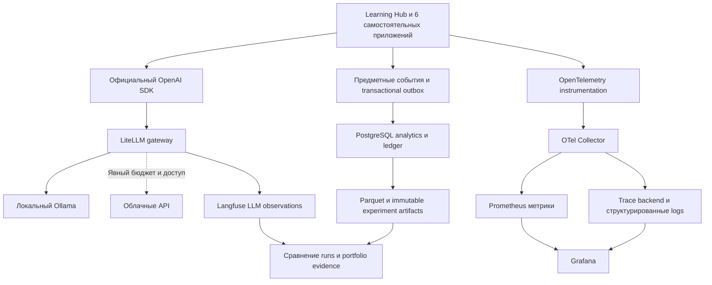

# Наблюдаемость платформы и шести проектов, хранение данных и управление Ollama

**Статус: конкретный проект для рассмотрения, 0.1.0; сервисы, сборщики и переключатель ещё не реализованы.** Дата: 2026-11-27, Europe/Moscow. Задача Beads `aie-8oq`. Эта спецификация уточняет способ измерений по существующим результатам M03/M06/M08; она не меняет утверждённые критерии, каталог курса, исторические записи или освоение ученика.

Цель — принимать инженерные решения по проверяемым измерениям и получить воспроизводимые кейсы портфолио: задача → исходное состояние → гипотеза → изменение → результат → ограничения. Учебная платформа является отдельным седьмым приложением для измерений; шесть capstone сохраняют самостоятельный запуск и предметную приёмку.

## 1. Фактическое состояние и ограничения

Проверено read-only в этой сессии:

- Ollama `/api/version`: `0.24.0`; systemd-сервис `active`; loopback `127.0.0.1:11434` отвечает.
- `/api/ps`: `models: []`. Это означает отсутствие загруженных моделей на момент проверки, а не отсутствие установленной модели.
- Скачаны `qwen2.5-coder:7b` (4 683 087 561 bytes), `embeddinggemma:latest` (621 875 917 bytes), `qwen3-coder:latest` (18 556 700 761 bytes). Новые модели не скачивались, существующие не загружались/не выгружались этой работой.
- RTX 3050 Laptop: 4096 MiB VRAM, занято около 1 MiB на проверке. Состояние GPU динамическое; это не benchmark скорости.
- Раздел проекта: 937 GiB total, около 22 GiB available, 98% used (`df -h`). Это основное ограничение для немедленного развёртывания нескольких observability-хранилищ. Ничего не удалять без отдельного запроса.
- Docker daemon отвечает, версия 27.3.1; наличие Docker не означает достаточную ёмкость или уже установленный observability stack.
- В Learning Hub сейчас нет встроенного AI-наставника; только `llm-smoke` обращается к модели. Нет реальных попыток/зачётов, данных об эффективности наставника или улучшений capstone.

Ollama различает установленную и загруженную модель: [running models API](https://docs.ollama.com/api/ps). Современный self-hosted Langfuse использует PostgreSQL, Redis/Valkey, ClickHouse и object storage; его Docker Compose разворачивает несколько сервисов и сам по себе не обеспечивает HA/backup: [архитектура](https://langfuse.com/self-hosting), [Compose](https://langfuse.com/self-hosting/deployment/docker-compose).

## 2. Рассмотренные варианты

| Вариант | Что даёт | Компромисс |
|---|---|---|
| Только JSONL/Parquet и SQL-отчёты | Самый небольшой локальный старт, доказательства сохраняются до UI | Меньше практики эксплуатации и нет готового полноценного realtime UI |
| Полный Langfuse + OTel + Prometheus/Grafana + log/trace backends постоянно | Все эксплуатационные поверхности доступны сразу | Много сервисов, расход диска/RAM, при текущих 22 GiB свободного места риск остановить рабочую машину |
| **Один контракт данных, несколько runtime-профилей — рекомендован** | Измерения с первого сценария, одинаковые IDs/события/формулы; полноценные инструменты подключаются по этапам | Нужно заранее определить источники истины, дедупликацию и экспорт; сравнивать профили по накладным расходам |

Рекомендация автора — третий вариант; выбор не выдаётся за уже одобренное изменение архитектуры. Разрабатывать observability и отчётность с первого сценария. Изучать полную эксплуатацию до завершения соответствующих модулей; временно не запущенный тяжёлый backend не означает отказ от навыка.

## 3. Набор метрик и приоритеты

[Полный каталог](../../observability/metric-catalog.md) содержит **142 определения**; [JSON](../../observability/metrics.json) — их единый машиночитаемый источник версии `0.1.0-proposal`. Ни одно определение не содержит выдуманных измерений. Для каждого приложения выбраны три основных показателя; диагностические показатели не перегружают первый экран.

| Приложение | Три основных показателя | Ключевые ограничения |
|---|---|---|
| Learning Hub | Самостоятельный перенос; сохранение знаний на повторении; цена проверенно полезного ответа наставника (до его появления N/A) | Нет фиктивного освоения; нет потери сохранённых попыток; повторение показывается вместе с охватом due-проверок |
| Поддержка/возвраты | Корректно разрешённые обращения; API-cost на успешную задачу; активное время оператора | Нет возврата без одобрения; нет двойного финансового эффекта |
| Аналитик инцидентов | Корректные разборы; API-cost на успешную задачу; активное время triage | Ложные причинные выводы; отсутствие самовольных remedial-действий |
| Аудитор договоров | Recall критических учебных рисков; API-cost на успешную задачу; активное время проверки | Precision флагов; верная версия документа и цитаты |
| Text-to-SQL | Правильный результат по oracle SQL; API-cost на успешную задачу; полезная пропускная способность | Нет исполненного опасного SQL и межтенантного чтения/выдачи |
| Помощник рекрутера | F1 извлечённых фактов; API-cost на успешную задачу; активное время проверки | Нет выдуманного опыта; нет автоматического решения о найме |
| CRM ассистент | Правильные изменения; API-cost на успешную задачу; исправления оператора | Нет записи без одобрения и повторных эффектов; внешние сообщения не отправляются |

Для всех применимы: latency p50/p95, TTFT, очередь, ошибки/таймауты/отмена, токены, cache hit/staleness, retry/fallback, качество retrieval/citations, tool outcomes, VRAM, загрузка/выгрузка модели и здоровье самой телеметрии. Нулевые нарушения в определённом наборе тестов — инвариант приёмки этого набора, не доказательство абсолютной безопасности.

## 4. Источники истины и владение данными

| Данные | Авторитетный источник | Что не считать источником истины |
|---|---|---|
| Программа/критерии/паспорта | Версионированные JSON/Markdown в Git и content-lock | Значения на dashboard или резюме |
| Текущие попытки/оценки/evidence | Существующие immutable `learning_records/` + hashes + snapshot каталога | Событие просмотра урока, закрытая задача Beads, ответ LLM |
| Задачи разработки/обучения | Отдельный native Beads `aie`, проверяемые public snapshots | Новая таблица задач в analytics DB |
| Бизнес-состояние capstone | Собственная БД/immutable audit соответствующего приложения | Langfuse/Prometheus logs |
| Денежный/usage ledger | Unsampled нормализованные provider attempts и независимые сверки, PostgreSQL после подключения core DB | Сумма показаний gateway + Langfuse; sampled traces |
| Сравнение эксперимента | Immutable manifest + case results + raw durations/usage + рубрика + hashes | Только красивый график или агрегированный p95 |
| Настройки допуска локального AI | Private durable control state одного controller | Положение переключателя в браузере или наличие модели на диске |

Learning Hub не мигрирует попытки из JSON в PostgreSQL этим проектом. Analytics получает проекции без смены критерия освоения. Для попыток источник события — сохранённый canonical record ID/hash; периодическое сверяющее чтение находит пропуски и повторная доставка дедуплицируется. Сохранение attempt не зависит от доступности telemetry backend. Просмотры/клики допускают bounded best-effort доставку с явным drop count и не определяют освоение.

Новые capstone с transactional DB записывают бизнес-состояние и outbox в одной транзакции. Publisher доставляет at-least-once; потребитель UPSERT/UNIQUE по `event_id`, а не обещание exactly-once transport. Для внешнего sandbox эффекта — idempotency key, durable intent и reconciliation. Недоступность обязательного business audit блокирует эффект; недоступность Grafana не должна блокировать чтение урока.

## 5. Логическая архитектура

OTel задаёт instrumentation и сквозной контекст; Collector принимает, обрабатывает и экспортирует сигналы. Это не долговременное хранилище: [сигналы](https://opentelemetry.io/docs/concepts/signals/), [Collector](https://opentelemetry.io/docs/collector/).

- **LiteLLM**: общий gateway как отдельный сервис, route aliases, scoped keys, лимиты, retries/fallback. Начальный allowlist содержит только localhost/Ollama. Наличие loopback proxy не доказывает локальность upstream; cloud не должен появиться через fallback. Прямой SDK→Ollama сохраняется как учебный baseline.
- **Langfuse**: LLM observations, prompt/version, evaluation scores и UI разбора. Для одного upstream call выбирается один источник LLM observation (gateway callback либо приложение); не отправлять одну generation через два интегратора без дедупликации. App spans добавляют предметный контекст. [Gateway logging](https://docs.litellm.ai/docs/proxy/logging), [Langfuse cost tracking](https://langfuse.com/docs/observability/features/token-and-cost-tracking).
- **Prometheus**: counters/gauges/histograms системной работы. В метриках bounded labels `service`, `environment`, `route_template`, `operation`, `status_class`, `model_alias`. Trace IDs, user IDs, document IDs, full URLs, prompt/hash/run UUID не labels. Они находятся в traces/events/SQL. [Официальные рекомендации](https://prometheus.io/docs/practices/naming/).
- **Grafana**: состояние, SLO, queue/GPU/storage и drilling в связанные traces; не заменяет приложение курса.
- **Trace/log backend**: в core bounded JSONL с корреляцией, в полном профиле Tempo/Loki либо документированно проверенный эквивалент. Langfuse остаётся специализированной LLM-поверхностью. Сквозной `trace_id` и ссылки связывают backends; их объёмы/стоимости не суммируются как бизнес-вызовы.
- **PostgreSQL**: analytics events, unsampled usage/cost, experiment manifests, evaluations и агрегаты. Бизнес-БД проектов и metadata Langfuse имеют отдельные DB/roles, даже при общей локальной instance. Нет прямого чтения внутренних таблиц Langfuse в нашем приложении: только поддерживаемые API/exports.
- **Artifact storage**: immutable raw case results, версии workloads и отчёты. Сначала локальный каталог с manifest/hash; в полном профиле S3-compatible backend через единый interface. Нет необходимости запускать все шесть продуктов или все backends ради показа одного проекта.

## 6. Контракт события и корреляция

Все события содержат `event_id`, `schema_version`, `occurred_at_utc`, `ingested_at_utc`, `service`, `project_id`, `environment`, `event_type`, `request_kind`, `operation_id`, `trace_id`, `span_id`, `git_commit`, `configuration_hash`, `status`, `duration_ns` (когда применимо), `actor_kind` (learner/mentor/agent/system/test), `data_classification` и `source_record_id/hash`.

Эксперимент дополнительно несёт `run_id`, `case_id`, `workload_version/hash`, `rubric_version`, `variant`, `model_alias/digest`, `prompt_version`, `retrieval_index_version`, `seed_policy`, `concurrency`, `hardware_manifest`, `cache_state`, `instrumentation_profile`. Ключи корреляции — поля traces/SQL, не неограниченные labels.

Для событий вне request trace поля trace_id/span_id nullable с причиной; нельзя придумывать фиктивную связь. `event_id` стабилен при replay, а новая попытка получает новый ID.

Разделять `operation_id` пользовательской/предметной задачи и уникальный `upstream_attempt_id` каждого реального обращения. Собственный retry, retry gateway и fallback должны давать новые attempts с общей operation. Фоновый warmup, health check, benchmark, tutor, lab и project — разные `request_kind`; они не накручивают полезные пользовательские задачи.

Длительности измеряются monotonic clock. Wall UTC используется для времени/связей; clock skew отмечается. HTTP200/валидный JSON/выполненный tool call не равны успеху предметной задачи. Потоки получают отдельные first_content/end/cancel события. Незавершённые после crash операции восстанавливаются reconciliation либо остаются unknown, не превращаются в success/нулевую стоимость.

## 7. Схема хранения

Планируемые собственные PostgreSQL таблицы, с версионированием схем и миграциями:

| Таблица | Grain и ключ | Основные поля/назначение |
|---|---|---|
| `operation_events` | append-only event, UNIQUE(event_id) | Идентификаторы, тип, parent/source record, статус, время, payload по allowlist |
| `operations` | одна operation_id | Read model жизненного цикла; terminal state и retry-safe upsert |
| `provider_attempts` | один upstream_attempt_id | Model/provider, route, input/output/cache usage, error/retry/fallback, timings, raw usage schema version |
| `cost_entries` | append-only attempt/component/revision | Decimal amount/currency, basis, price_snapshot_id, amendment link; неполные суммы помечены |
| `price_snapshots` | версия тарифа | URL, valid/checked_at, per-unit categories, currency, pricing region/tier; тариф не задним числом перезаписывает ledger |
| `experiment_runs` | run_id | Manifest, workload/config/code/rubric/hardware hashes, baseline relationship, sampling/load/cache settings |
| `case_results` | run_id/case_id/repetition/rubric | Correctness labels, outcomes, durations, rejection/timeout/censoring, references to source artifacts |
| `review_events` | review event | Active/wall time отдельно, method/self-reported marker, edits, assistance/actor; без тела резюме/ответов |
| `tool_audit` / `query_audit` | tool effect/query attempt | Authorized/expected/actual effect, idempotency scope, tenant checks, statement category без секретов |
| `ingestion_audit` / `outbox` | delivery/event | Retries, dedup, queue age, drop/unknown reasons и acknowledgements |
| `backup_runs` / `recovery_drills` | drill/run | Subject hashes, coverage, measured recovery time и результат |

Индексы: event ID unique; `(project_id, environment, occurred_at)`; `(run_id, case_id)`; `(operation_id, started_at)`; partial index для pending outbox. Partitioning по времени вводить при измеренном размере/плане retention, не создавать тысячи пустых partitions заранее. Numeric quantities используют единицы в имени/схеме; деньги — `NUMERIC`, не float. UTC timestamps — timestamptz; duration ns — bigint. Долгие тексты/вложения — artifact refs, не каждый log row.

Cost basis: `provider_reported`, `estimated`, `invoice_reconciled`, `unknown`, `not_applicable`. Provider-reported usage не означает выставленный счёт. Cached input часто входит в total input, reasoning — в output: нормализация версионирована и хранит исходный usage object без секретов. Неизвестное значение — null + причина, не0. При неполном cost coverage отчёт показывает incomplete/lower bound и не делает вывод о полной экономии.

Приложения не суммируют gateway spend, Langfuse spend и собственный ledger: это наблюдения одной операции. Сверка сопоставляет их по attempts/time/scope. Для после/до: отдельно фактические расходы по применимому тарифу и сравнение с одинаковым price snapshot, если нужно отделить оптимизацию от изменения цены. Eval/judge/ingestion расходы отделены от serving cost; amortization embeddings/index build явная. Локальный API-bill может быть0, но GPU/RAM/электричество/время не объявляются бесплатными или измеренными без источника.

## 8. Где и сколько хранить

Пути ниже — предложения, не уже созданные volumes. Runtime данные исключены из публичного Git.

| Класс | Core место | Полный профиль | Начальная retention/квота предложения |
|---|---|---|---|
| Учебные попытки/оценки/evidence | Существующие `learning_records/`, локально; чувствительное хранить приватно | Отдельная будущая миграция только с проверкой и явным решением | Без TTL; hashes и история не удаляются автоматически |
| Предметное состояние/audit | Собственная БД проекта | PostgreSQL + domain-specific storage | Зависит от project policy; evidence, на которое ссылается приёмка, закреплено |
| Общие events/usage/cost | Bounded JSONL spool, затем own PostgreSQL projections/ledger | PostgreSQL + Parquet cold export | Raw active telemetry30дней; monthly/release summaries и pinned evidence без автоудаления |
| Системные logs | JSONL rotation в private `runtime/observability/` | Loki | 7дней и hard size cap; тела запросов по умолчанию выключены |
| Метрики временных рядов | Exporter + небольшой Prometheus profile | Prometheus/Grafana | 14дней и size cap, что наступит раньше; pinned benchmark samples отдельно |
| Сквозные traces | Correlated JSONL, bounded exporter spool | Tempo + Langfuse selected LLM observations | Обычные7дней, benchmark14дней; доказательства релиза экспортированы и закреплены |
| Наборы и результаты benchmark | `runtime/artifacts/<project>/<run>` + SHA manifest | S3-compatible private buckets | Валидированные release cases сохраняются; scratch runs можно TTL после проверки отсутствия refs |
| Beads | Native `.beads` | Тот же отдельный tracker + reviewed snapshots | Не подменять analytics DB, экспортировать без личных email |

Для нынешнего диска предложенный первоначальный **бюджет горячей телеметрии1GiB**, отдельно **до512MiB scratch experiments**. Это инженерные лимиты проекта, не утверждение о минимальных требованиях инструментов. Порог остановки тяжёлого нового benchmark — меньше10GiB available либо прогноз превышения своей квоты. При нынешних98%used не загружать новые images/weights автоматически. Полный профиль разрешать после preflight свободного места, RAM, image/volume размеров и отдельной подготовки ёмкости; условные лимиты пересмотреть по измерениям. Никакой автоочистки пользовательских файлов.

Ротация не удаляет evidence, на которое ссылается assessment/portfolio manifest. Garbage collector требует reference graph и dry-run; pinned data исключена. Spool overflow имеет явный alarm; обязательный ledger/eval record либо durable, либо операция/эксперимент помечается incomplete. Повседневная sampled telemetry не считается полноценным денежным/аудиторским журналом.

## 9. Надёжность, backup и приватность

- Бизнес-события, ledger и case results —100% учёт. Для ограниченных benchmark runs —100% нужных raw samples. Для обычных traces sampling конфигурируется отдельно; сохраняются ошибки/редкие сценарии в пределах явно ограниченного tail buffer. Если head sampling не передаёт ошибочный span, downstream не может обещать100% ошибок: профиль и coverage обязательны.
- `telemetry_drop_count`, backlog age, cost/usage coverage и свободный диск — отдельные видимые показатели. Серый unknown означает неизвестность, а не хороший зелёный ноль.
- Проверять PII/secret redaction synthetic canaries на каждом sink. Prompts/responses по умолчанию не логировать; full-content debug только с synthetic fixtures, ограниченным сроком и явной настройкой. HMAC/псевдонимы не объявлять гарантированной анонимизацией.
- Public Git: только схемы, код/конфигурация без секретов, синтетические наборы и очищенные доказательства. Полные личные попытки/чужие документы/production-логи в публичный репозиторий не публиковать. Учебные метаданные не использовать для решений о найме реальных людей.
- Docker volumes на том же SSD — persistence, не независимый backup. Проверяемые snapshots/postgres dumps и artifact manifests должны экспортироваться на выбранный отдельный носитель/приватное хранилище. Сейчас такой destination не выбран и off-device backup не заявлен. Секреты/ключи шифрования отдельно от архива.
- Restore drill подтверждает IDs/counts/hashes, cost/eval completeness, отсутствие дублей и повторяемость отчёта. Замер recovery time относится к этому стенду/объёму, не production RTO/RPO обещанию.
- TTL/удаление учитывает cache/index/trace/artifact copies и сроки backup. Операционные retention правила не могут молча ломать долгосрочную историю освоения.

## 10. Сравнение до/после и портфолио

Текущая платформа на commit `4a97468` — исходное состояние до этой спецификации. Исторические измерения не восстанавливаются выдуманными числами: первый baseline снимается до добавления наставника/управления и до оптимизаций. Отдельный парный прогон измеряет накладные расходы instrumentation; изменение runtime-профиля observability фиксируется в manifest. Для benchmark знаменатель качества включает все заранее назначенные eligible cases, в том числе отказы admission, ошибки и таймауты: нельзя повысить качество, незаметно исключив трудные задачи.

Три baseline роли сохраняются раздельно:

1. **A: существующие правила/шаблоны/ручной процесс без LLM**, как в утверждённых паспортах; показывает цену сложности и предметную пользу AI. Его LLM bill обычно0, нельзя приписать AI снижение относительно этого нулевого bill.
2. **B: первый корректно работающий LLM workflow**, с инструментированием до оптимизаций.
3. **C: оптимизированный LLM workflow**. Экономия LLM serving cost — сравнение B/C; ценность AI — сравнение A/B/C по качеству/времени/покрытию и стоимости с ясным scope.

Сохранять один holdout/workload, rubric, критерии включения/отказа, raw samples и manifest. Различия модели/кеша/индекса/квантизации — явные intervention variables. Workload, concurrency, аппаратные ограничения и методика совпадают, если не являются предметом эксперимента. Cold/warm/cache-hit runs отдельно. Отдельно фиксировать прогрев и окно измерений; latency включает queue. Результаты по failures/timeouts не выбрасываются из знаменателя качества.

Не усреднять p95 разных shards/окон. Парное сравнение — по одним cases; повторные stochastic runs имеют seed/repetition policy. При расчёте uncertainty кластеризовать по независимому case, не притворяться, что десять повторов одного вопроса — десять разных задач. Малые выборки и интервалы сообщать; performance benchmark и human active-time experiment имеют разные единицы анализа. Проценты улучшений не назначаются заранее; thresholds качества/latency утверждаются после baseline и до проверки candidate.

Перед принятием оптимизации: сравнимость manifest → полнота accounting → качество и обязательные инварианты → p95/errors → цена/throughput → overhead observability. Не прошедший кандидат остаётся воспроизводимым неудачным экспериментом, не скрывается. В production причинность требует дизайна rollout/контроля; в локальном пет-проекте заявлять только стендовый результат.

Примеры гипотез, без обещаний улучшения:

| Проект | Проверяемое изменение | Что может ухудшиться |
|---|---|---|
| Поддержка | Version-aware FAQ cache / routing простых запросов | Устаревшая политика, неверный отказ, пропущенное одобрение |
| Инциденты | Нормализация/отбор evidence до LLM | Пропущенная причина или временная связь |
| Договоры | Hybrid + reranking + parent-child context | Цена retrieval/парсинга, recall критических условий |
| SQL | Семантически валидированный template/cache route | Ошибка определения метрики/периода/tenant |
| Рекрутинг | Разделение factual extraction и нормализации | Потеря provenance, выдуманный опыт, пропущенный unknown |
| CRM | Сжатие памяти и version-aware retrieval | Устаревшие факты, конфликт версий/удаления, потеря нужного одобрения |

Каждый release сохраняет `manifest.json`, `case-results.jsonl/parquet`, metric summary с numerator/denominator/units, сопоставление baseline/candidate, источники цен и hardware manifest, ссылки trace IDs и `portfolio.md`. Публичный отчёт содержит N, workload, условия, baseline/after/delta, quality/safety guardrails, ограничения и роль автора. Стендовый triage time не называть production MTTR; CRM корректность не превращать в рост продаж; synthetic evidence extraction не выдавать за успешность найма; личное обучение одного человека не доказывает эффективность курса для популяции.

## 11. Управление моделью в UI

Цель — управлять доступом платформы к локальному inference и residency выбранной модели без root, `systemctl stop`, смены драйверов и удаления весов.

### Что видит пользователь

- Переключатель **«Локальный AI в учебной платформе»** — admission policy Learning Hub, сохраняемая после restart.
- Состояния отдельно: **Ollama доступен / недоступен / неизвестно**; **модель скачана**; **выгружена / загружается / загружена / освобождается / ошибка / наблюдение устарело**.
- Кнопки **«Загрузить сейчас»** и **«Выгрузить из памяти»**, имя allowlisted модели, размер VRAM из `/api/ps`, время последней проверки. GPU memory всего хоста отдельно: она не равна памяти одной модели.
- «Разрешено» не означает «постоянно загружено»; загрузка по первому запросу или явный warmup. Выгрузка не удаляет скачанную модель. Сохраняемые метрики: load/unload durations, failures, in-flight, requested/observed divergence.

Ollama позволяет preload пустым `/api/generate` или `/api/chat`, управлять residency через `keep_alive`, а `keep_alive:0` использовать для unload. [Официальный FAQ](https://docs.ollama.com/faq#how-do-i-keep-a-model-loaded-in-memory-or-make-it-unload-immediately). Внедрение проверяет эти операции на установленной0.24.0; новая документация сама по себе не доказывает поведение установленной версии.

### Предлагаемый backend контракт

- `GET /api/model/status`: read-only, bounded version/ps/tags probes; enabled policy, observed state, timestamp, freshness, in-flight, last sanitized error.
- `POST /api/model/policy`: enable/disable всех generation и embedding requests встроенных функций Learning Hub. CSRF + trusted loopback Host/Origin; состояние хранится в private `runtime/model-policy.json` atomic replace, не в Git.
- `POST /api/model/load`: allowlisted fixed local endpoint/model, bounded background warmup, operation ID; без произвольного command/base_url/model download. Обычная генерация по-прежнему через официальный SDK; lifecycle — через родной Ollama API.
- `POST /api/model/unload`: закрыть/проверить admission, drain собственных in-flight по deadline, затем `keep_alive:0`, наблюдать `/api/ps`. Занятый controller —409 либо queued control operation; никакого shell execution.

В core один controller actor/очередь операций и один app worker для control plane; mutex только внутри одного процесса не обещает межпроцессную защиту. Multiworker требует отдельного controller service/согласования lease до включения, не копирования in-memory флага. Старт policy fail-closed до чтения durable state; отключение подтверждается после сохранённого admission gate. Статус читается независимо от Langfuse/PostgreSQL аналитики.

**Граница управления:** все будущие модельные вызовы встроенных функций Hub проходят через его controller; прямой обход SDK из route запрещён архитектурным контрактом. Существующий отдельный `llm-smoke`, учебный прямой SDK baseline и шесть самостоятельно запускаемых capstone — независимые клиенты, которым этот переключатель не обещает запрет. При их включении в общий режим нужен центральный admission API с регистрацией каждой in-flight операции, включая embeddings; общий JSON-файл и mutex Hub этого не обеспечивают. В отдельном режиме каждый проект имеет собственную конфигурацию допуска. UI явно показывает область «только учебная платформа», а события содержат `application_id` и `request_kind`.

**После crash:** сохранённая policy применяется до допуска новых вызовов. Прежние in-flight операции считаются неизвестными до reconciliation; их нельзя объявить завершёнными или автоматически повторять эффект. При старте controller выполняет read-only probes и помечает незавершённую control operation interrupted/unknown. Автоматический unload после crash не выполняется: живой внешний запрос или сохранившаяся модель возможны. Пользовательская команда unload повторно проверяет текущее состояние.

Ollama остаётся общим сервером. Controller управляет собственными запросами, не знает гарантированно про все внешние клиенты. Внешняя программа может снова загрузить модель, поэтому нельзя обещать глобальное «AI выключено» или остановку чужих запросов. Unload — явно выбранная операция над конкретной моделью с обработкой busy/conflict и последующей проверкой; общий systemd-сервис не останавливается.

Начальный allowlist — установленный `qwen2.5-coder:7b`; embedding модель включается по конкретному уроку. 18GB `qwen3-coder` не выбирать автоматически. Контекст/concurrency ограничиваются и измеряются; residency частично в CPU/RAM допустима на4GB GPU, она не выдаётся за100%GPU.

### Проверки перед зачётом реализации

Fake Ollama transport: offline/version-only/empty-ps/installed-not-loaded/load-success/load-timeout/busy-unload/unload-success/ps-stale/unknown-shape. Concurrent enable/disable/load/request; disable не пропускает новые generation/embedding requests Hub, in-flight и внешние вызовы имеют явные границы. Restart сохраняет policy, после crash старые операции сверяются без автоматического replay/unload; read-only GET ничего не грузит. CLI/capstone не выдают policy Hub за свой gate. CSRF/foreign Host/path injection/cloud route отклоняются. Telemetry outage не стирает попытки и control state. После unit/integration проверок — bounded real local load/unload при явном переходе к внедрению; никаких платных запросов или новых downloads.

## 12. Профили внедрения и порядок

1. **Contract/core:** утвердить определения и источник истины; instrumentation с первого пользовательского/AI-сценария, schema versions, JSONL bounded spool, immutable run artifacts и reconciliation с существующими learning records. Встроить read-only model status.
2. **Model control:** добавить policy/load/unload по описанному контракту и соответствующие проверки. Включение модели не означает готовность AI-наставника: он отдельная функция.
3. **Operational:** после capacity preflight подключить own PostgreSQL analytics/ledger, OTel Collector, Prometheus/Grafana. Обновить storage budgets по фактическим измерениям; dashboards различают unknown/N/A/no data/0.
4. **LLM observability:** LiteLLM и Langfuse в отдельных Compose profiles; весь обмен локальный, ключи scoped, cloud отсутствует в route allowlist. При недостатке диска подготовить ёмкость отдельно, не делать автоматическую очистку.
5. **Full drills:** trace/log backend, failure injection, replay, backup/restore, long-run overhead и ingestion lag. Провести baseline A/B/C по проекту перед любой историей успеха.
6. **Portfolio:** валидировать один законченный кейс, приложить evidence и самостоятельно защитить решения; затем тиражировать общий контракт на остальные проекты с их отдельными рубриками.

Никакие новые сервисы, зависимости, UI-кнопки или модельные операции этим документом не установлены/выполнены. Конкретный implementation plan пишется после рассмотрения этого проекта; deployment и изменение канонических критериев не подразумеваются публикацией draft.
